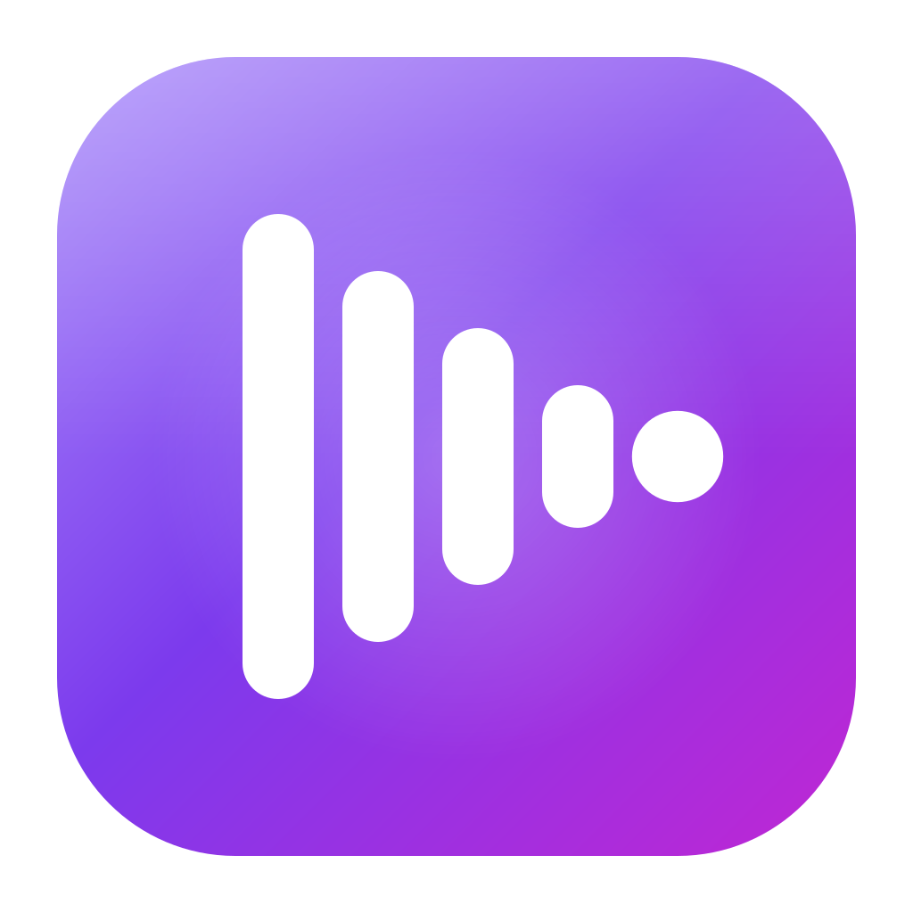

<p align="center">
  
</p>

<h1 align="center">BeatNode Desktop</h1>

A local-first music and video player for macOS, Windows and Linux. Point it at your folders, it builds the library, and your playlists can follow you across machines through any synced folder (Dropbox, iCloud Drive, Syncthing, a USB stick).

No account, no server, nothing leaves your machine.

## Features

- Plays audio (`mp3`, `flac`, `wav`, `m4a`, `aac`, `ogg`, `oga`, `opus`, `weba`) and video (`mp4`, `m4v`, `webm`, `mov`, `mkv`, `ogv`)
- Watched folders: add a folder once, new files are picked up and removed files disappear on their own
- Add individual files from the file dialog
- Tags and cover art read from the files, video thumbnails generated on import
- Playlists with per-track menu
- Shuffle, repeat (off / all / one), volume, seek
- Playlist sync through a plain folder, with last-edit-wins merging
- Keeps playing in the tray when you close the window
- System media keys and Now Playing integration
- Light, dark or follow-system theme

## Keyboard shortcuts

| Key | Action |
| --- | --- |
| Space | Play / pause |
| Left / Right | Seek 5 seconds |
| Up / Down | Volume +/- 5% |
| M | Mute |

## Getting started

Requirements: Node 18+ and Yarn. `better-sqlite3` is a native module, so you need a working build toolchain the first time (Xcode CLT on macOS, build-essential on Linux, VS Build Tools on Windows).

```bash
yarn install
yarn dev
```

`postinstall` rebuilds native dependencies against Electron's ABI. If you ever switch Electron versions and the app crashes on launch complaining about `better-sqlite3`, run `yarn postinstall` again.

### Scripts

| Script | What it does |
| --- | --- |
| `yarn dev` | Vite + Electron with hot reload |
| `yarn build` | Type check, bundle, and package an installer into `release/<version>` |
| `yarn lint` | ESLint, zero warnings allowed |
| `yarn preview` | Preview the renderer bundle in a browser |

Installers: `dmg` on macOS, NSIS `exe` (x64) on Windows, `AppImage` on Linux. The `appId` and `productName` in [electron-builder.json5](electron-builder.json5) are still placeholders, change them before shipping.

## How it works

```
electron/        main process
  main.ts          window, beatnode:// protocol, IPC wiring
  preload.ts       bridge exposed to the renderer
  db.ts            SQLite schema, migrations, queries
  library.ts       reads tags, grants file access, cover storage
  folders.ts       watched-folder scanning
  playlists.ts     validation of playlist data
  sync.ts          sync file read/write and watching
  background.ts    tray and background playback
  settings.ts      persisted settings

src/             renderer (React)
  features/
    player/          audio engine, queue, shortcuts, media session
    library/         library views, import, persistence, thumbnails
    playlists/       playlist views and store
    sync/            merge logic and sync hook
    settings/        folders, sync, background, theme
  components/      layout and shared UI
  shared/          types shared with the main process
```

### Storage

Everything lives in one SQLite file, `beatnode.db`, in the Electron `userData` directory (WAL mode, schema versioned with `user_version`). It holds tracks, playlists, excluded paths and settings. Older JSON files from early versions are imported once and renamed to `*.migrated`.

Generated cover and video thumbnails are stored next to it in a `covers` folder.

### File access

The renderer never touches the filesystem directly. Media is served through a custom `beatnode://` protocol that only answers for paths the main process has granted this session (picked in a dialog or found in a watched folder) and only for supported extensions. Range requests are supported, so seeking works.

If a watched folder becomes unreachable, for example an unplugged drive, the scan is skipped instead of treating every file as deleted.

### Sync

Sync only covers playlists, not the media files themselves. Pick a folder in Settings and BeatNode keeps a single `beatnode-sync.json` in it.

- Each playlist carries an `updatedAt`, newest edit wins per playlist
- Deleted playlists stay as tombstones for 30 days so deletes propagate
- Playlist entries reference tracks by an artist/title/album key, not by file path, so the same playlist resolves against a different library on another machine
- The file is validated on read since it comes from a cloud folder you don't fully control
- Writes go to a temp file and are renamed into place

Open the same sync folder on every machine and changes show up as the sync service delivers the file.

## Stack

Electron, React 18, TypeScript, Vite, Zustand, Tailwind CSS 4, better-sqlite3, music-metadata.

## Known limits

- Video support is whatever Chromium can decode (H.264/AAC mp4, VP8/VP9 webm). Other codecs may not play. This includes `mkv` files with HEVC video or DTS/AC3 audio, and embedded subtitles are not shown.
- Tracks are matched across machines by tags, so untagged files with the same name can collide.
